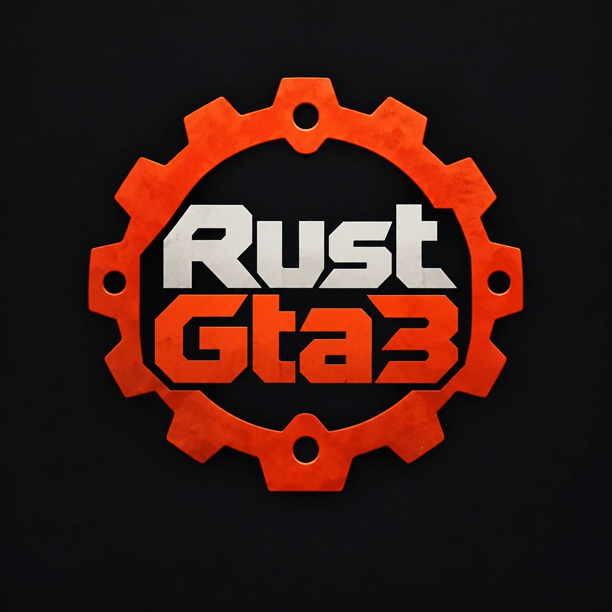
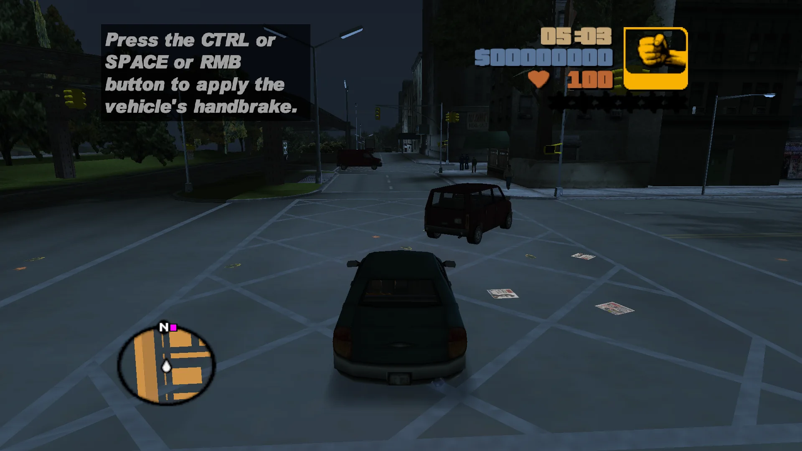
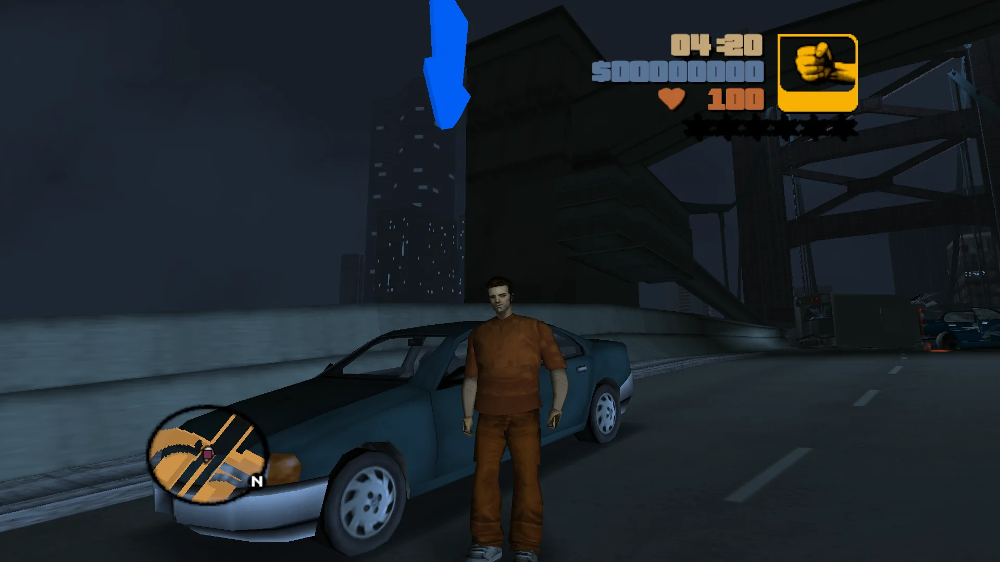
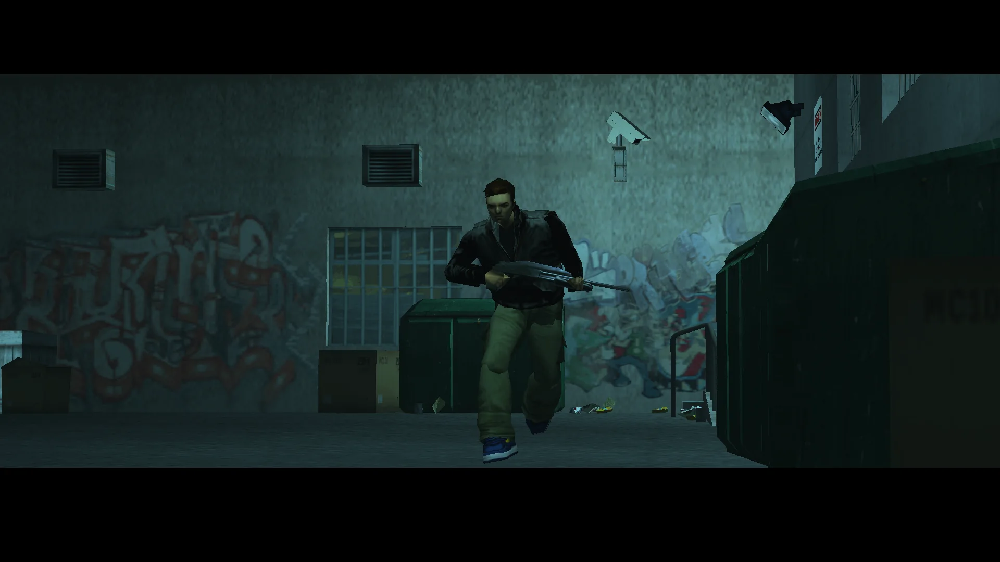

<p align="center">
  
</p>

<h1 align="center">RustGta3</h1>

<p align="center">
  <strong>GTA 3 (GTA III) in Rust: recreating Grand Theft Auto III gameplay with Bevy ECS.</strong><br>
  Drive, run and watch cutscenes in Liberty City, without the original executable.
</p>

<p align="center">
  <a href="https://www.rust-lang.org/"></a>
  <a href="https://bevyengine.org/"></a>
  
  
  
</p>

<p align="center">
  <a href="#gameplay">Gameplay</a> &nbsp;·&nbsp;
  <a href="#how-it-works">How it works</a> &nbsp;·&nbsp;
  <a href="#quick-start">Quick start</a> &nbsp;·&nbsp;
  <a href="#full-setup">Full setup</a> &nbsp;·&nbsp;
  <a href="#license-and-redistribution">License</a>
</p>

**RustGta3** is an experimental **Grand Theft Auto III reimplementation** built with [Rust](https://www.rust-lang.org/) and the [Bevy game engine](https://bevyengine.org/). It rebuilds GTA III's gameplay and runtime behavior from the ground up, with Bevy ECS managing the live game world. The assets come from **your own GTA III PC installation**.

Looking for **GTA 3 Rust**, **GTA III Rust**, **Grand Theft Auto 3 in Rust** or a **GTA 3 Bevy** project? This is an unofficial, experimental rebuild of GTA III's Liberty City gameplay as a Rust game, with Windows and Android ARM64 builds.

> [!NOTE]
> **Work in progress.** The full game is not yet playable. Features are incomplete, and save/runtime compatibility between commits is not guaranteed.
> **No game data is included.** You need your own lawfully obtained GTA III PC installation.

## Gameplay

Screenshots captured directly from a RustGta3 development build:

<p align="center">
  
</p>

<p align="center">
  
  
</p>

<p align="center"><sub>Driving · On foot · Cutscenes | Gameplay and rendering are still in development.</sub></p>

## How it works

| Area | Approach |
| :--- | :--- |
| 🦀 **Rust + Bevy ECS** | Bevy owns game entities, state and lifecycle. |
| 🎮 **GTA III behavior** | Reverse-engineered C++ references guide gameplay rules, timing and interactions. |
| 📁 **Your game assets** | Maps, models, audio and other data load from your GTA III installation. The original executable is never used. |
| 📦 **Self-contained** | Shaders (WESL) and the MPEG-1/MP2 video decoder ship inside the executable. No extra shader folders or video player needed. |
| 💻 **Desktop + Android** | Windows and Android ARM64 build paths are available, with touch controls on mobile. |

## Quick start

You need [Rust](https://www.rust-lang.org/tools/install), a C compiler and a lawfully obtained GTA III PC installation. From the repository root:

```bash
cargo run -p rustgta3 --profile runtime -- --gta-dir "path/to/GTA III"
```

<details>
<summary><strong>Want to save the GTA III path instead?</strong></summary>

Copy the example configuration and point it to your installation:

```powershell
Copy-Item config/original_gta3_path.txt.example config/original_gta3_path.txt
notepad config/original_gta3_path.txt
```

Then run `cargo run -p rustgta3 --profile runtime`. You can also place the executable in your existing GTA III directory.

</details>

Want Android or more run options? See [full setup](#full-setup).

## Full setup

### Game data

RustGta3 reads original textures, geometry, tables, animations and scripts from your installed game. Point it there with `--gta-dir`, the config file above, or by placing the executable in the GTA III directory. Frame limits are set in the in-game Display Settings menu.

Existing desktop saves and settings migrate automatically to `rustgta3-userfiles` beside the GTA III installation. If both the previous and new folders exist, neither is overwritten.

Installation checks only verify that the required game data is present. They do not authenticate a Rockstar account or prove a purchase, and no Rockstar Store ownership verification is integrated. Owning the game does not grant permission to redistribute the implementation or game data.

### Build and run

Builds need Rust and a C compiler for the embedded MPEG decoder (MSVC Build Tools on Windows, or the target C toolchain when cross-compiling).

```bash
# Default development build
cargo run -p rustgta3

# More representative gameplay build
cargo run -p rustgta3 --profile runtime
```

<details>
<summary><strong>Windows: running without Cargo</strong></summary>

On Windows, `cargo build` and `cargo run` also refresh `dist/rustgta3/` or `dist/rustgta3newgame/` for each game binary built. Open the executable there to run without Cargo. The folder includes its matching runtime DLLs, local path configuration, and the project and vendored decoder notices. Each folder holds the last build of that binary, including when switching profiles.

GTA III data stays in your original installation. These are local development outputs, not packages cleared for public redistribution; additional dependency notices and source availability requirements may apply.

</details>

### Android ARM64

With Android Studio's SDK/Command-line Tools and JDK 17 or 21 installed, run:

```powershell
./scripts/build-android.ps1
```

The script prepares missing toolchain components and produces a debug-signed APK at `dist/android/rustgta3-arm64.apk` (ARM64, Android 8+, Vulkan).

**The default APK contains no GTA III game data.** Copy your own PC game data to a folder on your phone, then choose that folder on first launch: the installation root containing `anim`, `audio`, `data`, `models` and `text`. The launcher copies the data into app-private storage, and saves/settings survive APK updates. Allow space for both the source folder and the imported copy.

Android now uses the app ID `org.rustgta3.game`. It installs separately from builds using the previous project name, so import your game data again; the previous app keeps its own saves and settings.

Controls: on-foot and vehicle buttons use the same gameplay input as desktop. Move with the left touch stick and drag the right side to look. Menu navigation includes OK and BACK buttons.

<details>
<summary><strong>Script options</strong></summary>

- `-Check` reports prerequisites without downloading or building.
- `-SetupOnly` prepares tools without compiling the game.
- `-PackageOnly` reuses the compiled ARM64 library if packaging fails after Rust compilation. After changing Rust code, run the normal command.
- `-BundleGameData` is for **local testing only**. It packages data from `config/original_gta3_path.txt` (or `-GtaDir <path>`) into `dist/android/rustgta3-arm64-private-with-game-data.apk`. Do not upload or redistribute this private package.

Building an APK without game data does not resolve the separate code and dependency licensing questions below.

</details>

## FAQ

**Is there a GTA 3 remake or reimplementation written in Rust?**
RustGta3 is an experimental attempt at one, built on the Bevy game engine. It is a work in progress and the full game is not yet playable.

**Does it include GTA III's game files?**
No. You need your own lawfully obtained GTA III PC installation. The default Android APK also contains no game data.

**Which platforms does it run on?**
Windows (via Cargo) and Android ARM64 (Android 8+, Vulkan) have development build paths.

**Is it official?**
No. It is an independent, unofficial project, not affiliated with or endorsed by Rockstar Games or Take-Two Interactive. See [License and redistribution](#license-and-redistribution).

## Reference source

Development uses optional local reverse-engineering references:

- [Jai-JAP/re-GTA](https://github.com/Jai-JAP/re-GTA): GTA III behaviour reference.
- [mrxenginner/reVC](https://github.com/mrxenginner/reVC): Vice City-era cross-reference.

The Rust build does not need these trees and does not link their C++ source. Do not include them in a public source archive. Their availability online does not establish redistribution permission. Source comments retain reference attribution, and the licensing questions also concern portions already translated into Rust. See [THIRD_PARTY_NOTICES.md](THIRD_PARTY_NOTICES.md).

## Contributing

Follow [AGENTS.md](AGENTS.md) and the relevant repository skills. Keep changes focused, and keep original game data, local configuration and generated outputs out of commits. Record the source and license of third-party material and preserve its notices. Contribute only material you are entitled to license; new original contributions use the scoped project MIT license. Do not submit unlicensed code translations or describe source-informed work as clean-room. Investigation results belong in the conversation unless a document is explicitly requested.

<details>
<summary><strong>Preparing source for publication</strong></summary>

Run `python scripts/check-source-distribution.py` before preparing source for publication. It checks candidate files for known game-data, build-output and local-configuration paths; it does not determine copyright ownership or clear publication.

A new Git repository must contain only the reviewed source snapshot, preserve the notices and omit reference checkouts and private files. After resolving the publication rights, create that snapshot without deleting your working repository or its history:

```powershell
python scripts/check-source-distribution.py --export dist/source/rustgta3
```

The destination must be new. The export omits Git metadata and reference checkouts. The export does not initialize a repository or upload anything.

</details>

## License and redistribution

Original game data is not part of the project's licensed source distribution. RustGta3 is an independent, unofficial project and is not affiliated with or endorsed by Rockstar Games or Take-Two Interactive.

[LICENSE](LICENSE) applies the MIT license only to original contributions whose copyright holders have authorized that license. Third-party code and reference-derived portions are not automatically relicensed by it. **Redistribution rights for the complete project remain unresolved.** See [THIRD_PARTY_NOTICES.md](THIRD_PARTY_NOTICES.md) for source provenance, exclusions and dependency obligations. This is not a fully cleared open-source release or a claim of clean-room development.

Do not publish game data, reference source trees, local configuration or private APKs containing game data. Requiring an original installation, distributing without charge and starting a fresh Git history do not by themselves establish permission to redistribute the implementation.

Grand Theft Auto, Grand Theft Auto III and related names, assets and trademarks belong to their respective rights holders.
