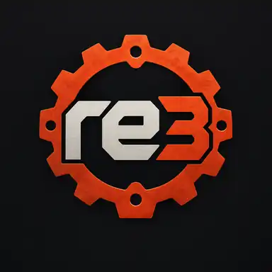

<p align="center">
  
</p>

<h1 align="center">re3bevy</h1>

<p align="center">
  <strong>Recreating GTA III gameplay in Rust with Bevy ECS.</strong>
</p>

<p align="center">
  <a href="https://www.rust-lang.org/"></a>
  <a href="https://bevyengine.org/"></a>
  
  
  
</p>

<p align="center">
  <a href="#gameplay">Gameplay</a> &nbsp;·&nbsp;
  <a href="#how-it-works">How it works</a> &nbsp;·&nbsp;
  <a href="#quick-start">Quick start</a> &nbsp;·&nbsp;
  <a href="#full-setup">Full setup</a> &nbsp;·&nbsp;
  <a href="#license-and-redistribution">License</a>
</p>

**re3bevy** is an experimental **Grand Theft Auto III reimplementation** built with [Rust](https://www.rust-lang.org/) and the [Bevy game engine](https://bevyengine.org/). The goal is to reproduce GTA III's gameplay and runtime behavior, with Bevy ECS managing the live game world.

Original game behavior is studied using reverse-engineered C++ references, including [re-GTA](https://github.com/Jai-JAP/re-GTA). The game assets come from **your own GTA III PC installation**, and the original executable is not used.

> [!NOTE]
> **Work in progress:** The full game is not yet playable. Features are incomplete, and save/runtime compatibility between commits is not guaranteed.

## Gameplay

Screenshots captured directly from a re3bevy development build:

<p align="center">
  
</p>

<p align="center">
  
  
</p>

<p align="center"><sub>Driving · On foot · Cutscenes | Gameplay and rendering are still in development.</sub></p>

## How it works

| Area | Approach |
| :--- | :--- |
| 🦀 **Rust + Bevy ECS** | Bevy owns game entities, state and lifecycle. |
| 🎮 **GTA III behavior** | Reference C++ guides gameplay rules, timing and interactions. |
| 📁 **Original game assets** | Maps, models, audio and other data are loaded from your GTA III installation. |
| 💻 **Desktop + Android** | Desktop and Android ARM64 build paths are available for development. |

## Quick start

You need [Rust](https://www.rust-lang.org/tools/install), a C compiler and a lawfully obtained GTA III PC installation. From the repository root:

```bash
cargo run -p re3bevy --profile runtime -- --gta-dir "path/to/GTA III"
```

<details>
<summary><strong>Want to save the GTA III path instead?</strong></summary>

Copy the example configuration and point it to your installation:

```powershell
Copy-Item config/original_gta3_path.txt.example config/original_gta3_path.txt
notepad config/original_gta3_path.txt
```

Then run `cargo run -p re3bevy --profile runtime`.

</details>

See [full setup](#full-setup) for other run options and Android instructions.

## Full setup

### Game data

Installation checks only verify the presence of required game data. They do
not authenticate a Rockstar account or prove a purchase. No Rockstar Store
ownership verification is integrated; game ownership does not grant permission
to redistribute the implementation or game data.

Copy the example configuration and point it at your GTA III installation:

```powershell
Copy-Item config/original_gta3_path.txt.example config/original_gta3_path.txt
notepad config/original_gta3_path.txt
```

Startup videos use the built-in MPEG-1/MP2 decoder; no external video player is required.

Alternatively, place the executable in the existing GTA III directory or pass
`--gta-dir "path/to/GTA III"`. Project-owned WESL shader code ships inside the
executable; original textures, geometry, tables, animations and scripts remain
in the installed game. No project shader folder or reference tree is needed at
runtime. Frame limits are configured in the in-game Display Settings menu.

### Build and run

Builds require Rust and a C compiler for the embedded MPEG decoder (MSVC Build
Tools on Windows; the target C toolchain when cross-compiling).

From the repository root, build and run:

```bash
cargo run -p re3bevy
```

For a more representative gameplay build:

```bash
cargo run -p re3bevy --profile runtime
```

On Windows, `cargo build` and `cargo run` also refresh `dist/re3bevy/` or
`dist/re3bevynewgame/` for each game binary built. Open the executable there to
run without Cargo: the folder includes its matching runtime DLLs, local path
configuration, and the project and vendored decoder notices. Each folder
contains the last build of that binary, including when switching profiles.
GTA III data remains in your
original installation. These are local development outputs, not packages
cleared for public redistribution; additional dependency notices and source
availability requirements may apply.

### Android ARM64

With Android Studio's SDK/Command-line Tools and JDK 17 or 21 installed, run:

```powershell
./scripts/build-android.ps1
```

The script prepares missing toolchain components and produces a debug-signed
APK at `dist/android/re3bevy-arm64.apk` (ARM64, Android 8+, Vulkan).
**The default APK contains no GTA III game data.** Copy your own PC game data
to a folder on your phone, then choose that folder on first launch. Select the
installation root containing `anim`, `audio`, `data`, `models` and `text`.
The launcher copies data into app-private storage; saves/settings survive APK
updates. Allow space for both the source folder and the imported copy.
On foot and vehicle buttons use the same gameplay input as desktop; move with
the left touch stick and drag the right side to look. Menu navigation buttons
include OK/BACK. `-SetupOnly` prepares tools without compiling the game;
`-Check` reports prerequisites without downloading or building.
If packaging fails after Rust compilation, retry with `-PackageOnly` to reuse
the compiled ARM64 library. After changing Rust code, run the normal command.

For local testing only, `-BundleGameData` explicitly packages data from
`config/original_gta3_path.txt` (or `-GtaDir <path>`) into
`dist/android/re3bevy-arm64-private-with-game-data.apk`. Do not upload or
redistribute this private package. Building an APK without game data does not
resolve the separate code and dependency licensing questions above.

## Reference source

Development uses optional local reverse-engineering source references:

- [Jai-JAP/re-GTA](https://github.com/Jai-JAP/re-GTA): GTA III behaviour reference.
- [mrxenginner/reVC](https://github.com/mrxenginner/reVC): Vice City-era cross-reference.

The Rust build does not need these trees and does not link their C++ source.
Do not include them in a public source archive. Their availability online does
not establish redistribution permission. Source comments retain reference
attribution; the licensing questions also concern portions already translated
into Rust or the parity harness. See [THIRD_PARTY_NOTICES.md](THIRD_PARTY_NOTICES.md).

## Contributing

Follow [AGENTS.md](AGENTS.md) and the relevant repository skills. Keep changes
focused and keep original game data, local configuration and generated outputs
out of commits. Record the source and license of third-party material and
preserve its notices. Contribute only material you are entitled to license;
new original contributions use the scoped project MIT license. Do not submit
unlicensed code translations or describe source-informed work as clean-room.
Investigation results belong in the conversation unless a document is
explicitly requested.

Run `python scripts/check-source-distribution.py` before preparing source for
publication. It checks candidate files for known game-data, build-output and
local-configuration paths; it does not determine copyright ownership or clear
publication. A new Git repository must contain only the reviewed source
snapshot, preserve the notices and omit reference checkouts and private files.
After resolving the publication rights, create that snapshot without deleting
your working repository or its history:

```powershell
python scripts/check-source-distribution.py --export dist/source/re3bevy
```

The destination must be new. The export omits Git metadata, reference
checkouts and the optional C++ parity harness, whose reference-derived code
needs separate permissions. Rust harnesses and synthetic fixtures are retained.
The export does not initialize a repository or upload anything.

## License and redistribution

Original game data is not part of the project's licensed source distribution.
re3bevy is an independent, unofficial project and is not affiliated with or
endorsed by Rockstar Games or Take-Two Interactive.

[LICENSE](LICENSE) applies the MIT license only to original contributions
whose copyright holders have authorized that license. Third-party code and
reference-derived portions are not automatically relicensed by it.
**Redistribution rights for the complete project remain unresolved.** See
[THIRD_PARTY_NOTICES.md](THIRD_PARTY_NOTICES.md) for source provenance,
exclusions and dependency obligations. This is not a fully cleared
open-source release or a claim of clean-room development.

Do not publish game data, reference source trees, local configuration or
private APKs containing game data. Requiring an original installation,
distributing without charge and starting a fresh Git history do not by
themselves establish permission to redistribute the implementation.

Grand Theft Auto, Grand Theft Auto III and related names, assets and trademarks
belong to their respective rights holders.
